# Big Data Music Analytics Pipeline

Solusi *data pipeline* untuk mengumpulkan, membersihkan, menganalisis, dan memvisualisasikan statistik pemutaran lagu lintas platform, seperti Spotify dan Apple Music menggunakan arsitektur Big Data 5 *layer*.

## Helicopter View Diagram

```mermaid
flowchart LR
    %% Definisi Warna per Layer
    classDef source fill:#FFF4E5,stroke:#FF9800,stroke-width:2px,color:#000
    classDef layer1 fill:#E3F2FD,stroke:#1976D2,stroke-width:2px,color:#000
    classDef layer2 fill:#E8F5E9,stroke:#388E3C,stroke-width:2px,color:#000
    classDef layer3 fill:#F3E5F5,stroke:#7B1FA2,stroke-width:2px,color:#000
    classDef layer4 fill:#E0F7FA,stroke:#0097A7,stroke-width:2px,color:#000
    classDef layer5 fill:#FCE4EC,stroke:#C2185B,stroke-width:2px,color:#000

    subgraph SRC["SUMBER DATA (3V)"]
        direction TB
        S1["Spotify Web API<br/>(Chart & Fitur Audio)"]:::source
        S2["Apple Music / iTunes API<br/>(Top Songs & Metadata)"]:::source
        S3["Dataset Publik<br/>(Histori Streaming Besar)"]:::source
        PROD["Python Log Producer<br/>(Standardisasi Skema JSON)"]:::source
        S1 --> PROD
        S2 --> PROD
        S3 --> PROD
    end

    subgraph L1["1. LAYER INGESTION"]
        direction TB
        KAFKA["Apache Kafka<br/>Topic: music-play-logs<br/>(3 Partisi & Log Replay)"]:::layer1
    end

    subgraph L2["2. LAYER STORAGE (HDFS)"]
        direction TB
        HDFS_RAW["HDFS Raw Zone<br/>/data/raw/ (Format JSON)<br/>Arsip & Audit Data"]:::layer2
        HDFS_CLEAN["HDFS Clean Zone<br/>/data/clean/ (Format Parquet)<br/>Partisi: platform / date"]:::layer2
    end

    subgraph L3["3. LAYER PROCESSING & ANALITIK"]
        direction TB
        SP_STR["Spark Structured Streaming<br/>- ETL & Validasi Skema<br/>- Agregasi Live (Window 1 Menit)"]:::layer3
        SP_SQL["Spark SQL (Batch)<br/>- Deskriptif: Top Songs & Tren<br/>- Diagnostik: Korelasi Audio vs Skip"]:::layer3
        SP_ML["Spark MLlib & Rule Engine<br/>- Prediktif: Viral Score (RF) & ALS<br/>- Preskriptif: Aturan Promosi/Playlist"]:::layer3
    end

    subgraph L4["4. LAYER SERVING"]
        direction TB
        SRV["Apache Hive / MongoDB<br/>- Tabel Live Play Count<br/>- Tabel Top Chart & Korelasi<br/>- Tabel Prediksi & Rekomendasi Aksi"]:::layer4
    end

    subgraph L5["5. LAYER VISUALISASI"]
        direction TB
        UI["Dashboard Streamlit<br/>- Grafik Batang: Top 10 Lagu<br/>- Grafik Garis: Tren Lintas Platform<br/>- Scatter Plot: Analisis Fitur Audio<br/>- Tabel Keputusan Preskriptif"]:::layer5
    end

    %% Aliran Data & Format Antar Layer
    PROD -->|"Aliran Event<br/>(JSON)"| KAFKA
    KAFKA -->|"Raw Log<br/>(JSON)"| HDFS_RAW
    KAFKA -->|"Stream<br/>Micro-Batch"| SP_STR
    SP_STR -->|"Write Bersih<br/>(Parquet)"| HDFS_CLEAN
    SP_STR -->|"Update<br/>Real-Time"| SRV
    HDFS_CLEAN -->|"Scan Kolom<br/>(Parquet)"| SP_SQL
    HDFS_CLEAN -->|"Training &<br/>Scoring"| SP_ML
    SP_SQL -->|"Hasil Agregasi<br/>(Tabel)"| SRV
    SP_ML -->|"Output Model<br/>& Aturan"| SRV
    SRV -->|"Baca Ringan<br/>(Low Latency)"| UI
```


## Arsitektur Sistem
1. **Data Source:** Skrip Python yang menarik katalog lagu dari API publik dan menyimulasikan aliran *event* pemutaran musik dalam format JSON terstandardisasi.
2. **Layer 1 - Ingestion:** **Apache Kafka** (`topic: music-play-logs`, 3 partisi) untuk menampung aliran data *real-time* dan mendukung fitur *log replay*.
3. **Layer 2 - Storage:** **HDFS** yang dibagi menjadi dua zona:
   * `/data/raw/music_logs/` (Format JSON untuk arsip mentah/audit).
   * `/data/clean/music_stats/` (Format kolom **Parquet** terpartisi berdasarkan `platform` dan `date` untuk optimasi pembacaan).
4. **Layer 3 - Processing & Analitik:** **Apache Spark** (*Structured Streaming*, *Spark SQL*, dan *MLlib*) untuk pembersihan data (ETL) serta analitik deskriptif, diagnostik, prediktif, dan preskriptif.
5. **Layer 4 & 5 - Serving & Visualisasi:** Penyajian tabel hasil agregasi yang ringan ke dashboard interaktif **Streamlit**.

## Struktur Folder
```text
bigdata-music-pipeline/
├── docker-compose.yml          
├── requirements.txt            
├── .gitignore                  
├── README.md                   
├── scripts/
│   ├── producer.py             
│   └── ingest_to_hdfs.py       
└── ivy_cache/                  
```

---

## Panduan 1: Untuk yang Belum Pernah Menjalankan

Ikuti langkah ini dari awal jika kamu baru melakukan `git clone` di komputer/VM baru.

### 1. Siapkan Environment Python dan Izin Folder Cache
Masuk ke direktori proyek, buat *virtual environment*, instal dependensi, dan berikan izin tulis pada folder `ivy_cache` agar kontainer Spark tidak mengalami error *permission*:
```bash
cd ~/bigdata-music-pipeline

# Buat dan aktifkan virtual environment
python3 -m venv .venv
source .venv/bin/activate

# Instal library Python
pip install -r requirements.txt

# Siapkan folder cache JAR untuk Spark
mkdir -p ivy_cache/cache
sudo chmod -R 777 ivy_cache
```

### 2. Jalankan Infrastruktur Docker (Kafka, HDFS, Spark)
```bash
sudo docker compose up -d
```
*Tunggu sekitar 15–20 detik hingga seluruh kontainer (`kafka`, `namenode`, `datanode`, `spark`) berstatus `Up` (cek dengan `sudo docker ps`).*

### 3. Buat Topic Kafka (Cukup Dilakukan 1 Kali)
Buat *topic* `music-play-logs` dengan 3 partisi:
```bash
sudo docker exec -it kafka /opt/kafka/bin/kafka-topics.sh \
  --create \
  --topic music-play-logs \
  --bootstrap-server localhost:9092 \
  --partitions 3 \
  --replication-factor 1
```

### 4. Jalankan Aliran Data (Terminal 1 - Producer)
Pastikan `.venv` aktif, lalu jalankan skrip pengirim data:
```bash
source .venv/bin/activate
python3 scripts/producer.py
```

### 5. Jalankan Ingestion Spark ke HDFS (Terminal 2 - Consumer)
Buka tab terminal baru, lalu jalankan *job* Spark Streaming (pada eksekusi pertama, Spark akan mengunduh paket JAR Kafka ke `ivy_cache` selama ~30–60 detik):
```bash
sudo docker exec -it spark /opt/spark/bin/spark-submit \
  --master local[*] \
  --conf spark.jars.ivy=/tmp/.ivy2 \
  --packages org.apache.spark:spark-sql-kafka-0-10_2.12:3.5.1 \
  /opt/spark-scripts/ingest_to_hdfs.py
```
Biarkan berjalan hingga muncul pesan `Batch 0 selesai disimpan...` dan seterusnya (minimal 1.500–2.000 *event*), lalu tekan `Ctrl + C` di kedua terminal untuk menghentikan aliran sementara.

---

## Panduan 2: Untuk yang Sudah Pernah Menjalankan

Jika kamu sudah pernah melakukan setup di atas (misalnya setelah mematikan laptop atau me-restart VM), **tidak perlu membuat ulang topic Kafka atau menginstal ulang library**. Data lama di HDFS dan *offset checkpoint* sudah tersimpan aman di dalam *Docker Volume*.

### 1. Nyalakan Kembali Kontainer Docker
```bash
cd ~/bigdata-music-pipeline
sudo docker compose up -d
```

### 2. Jalankan Ulang Pipeline (Saat Ingin Menambah Data / Live Demo)
* **Terminal 1 (Producer):**
  ```bash
  source .venv/bin/activate
  python3 scripts/producer.py
  ```
* **Terminal 2 (Spark Ingestion):**
  ```bash
  sudo docker exec -it spark /opt/spark/bin/spark-submit \
    --master local[*] \
    --conf spark.jars.ivy=/tmp/.ivy2 \
    --packages org.apache.spark:spark-sql-kafka-0-10_2.12:3.5.1 \
    /opt/spark-scripts/ingest_to_hdfs.py
  ```
  *Catatan: Spark akan langsung berjalan tanpa mengunduh ulang JAR dan otomatis melanjutkan pembacaan dari checkpoint terakhir tanpa duplikasi data.*

---

## Verifikasi & Reset Data (Opsional)

### Cek File Hasil di HDFS
* **Via Terminal:**
  ```bash
  sudo docker exec -it namenode hdfs dfs -count -h /data/raw/music_logs /data/clean/music_stats
  sudo docker exec -it namenode hdfs dfs -ls -R /data/clean/music_stats
  ```
* **Via Browser:** Buka `http://localhost:9870` $\rightarrow$ **Utilities** $\rightarrow$ **Browse the file system**.

### Menghentikan Sementara vs Reset Total
* **Mematikan kontainer tanpa menghapus data (Hemat RAM):**
  ```bash
  sudo docker compose stop
  ```
* **Menghapus seluruh data & memulai benar-benar dari nol (Reset Volume):**
  ```bash
  sudo docker compose down -v
  ```
  *(Jika menjalankan perintah reset ini, ikuti kembali **Panduan 1** mulai dari langkah ke-2).*
