# Big Data Music Analytics Pipeline

Solusi *data pipeline* untuk mengumpulkan, membersihkan, menganalisis, dan memvisualisasikan statistik pemutaran lagu lintas platform, seperti Spotify dan Apple Music menggunakan arsitektur Big Data 5 *layer*.

## Helicopter View Diagram

```mermaid
flowchart LR
    %% Definisi Warna per Layer
    classDef source fill:#FFF4E5,stroke:#FF9800,stroke-width:2px,color:#000
    classDef layer1 fill:#E3F2FD,stroke:#1976D2,stroke-width:2px,color:#000
    classDef layer2 fill:#E8F5E9,stroke:#388E3C,stroke-width:2px,color:#000
    classDef layer3 fill:#F3E5F5,stroke:#7B1FA2,stroke-width:2px,color:#000
    classDef layer4 fill:#E0F7FA,stroke:#0097A7,stroke-width:2px,color:#000
    classDef layer5 fill:#FCE4EC,stroke:#C2185B,stroke-width:2px,color:#000

    subgraph SRC["SUMBER DATA (3V)"]
        direction TB
        S1["iTunes / Apple Music API<br/>(Metadata & Katalog Lagu)"]:::source
        S2["Simulasi Multi-Platform<br/>(Spotify & Apple Music)"]:::source
        PROD["Python Log Producer<br/>(Standardisasi Skema JSON)"]:::source
        S1 --> PROD
        S2 --> PROD
    end

    subgraph L1["1. LAYER INGESTION"]
        direction TB
        KAFKA["Apache Kafka<br/>Topic: music-play-logs<br/>(3 Partisi & Log Replay)"]:::layer1
    end

    subgraph L2["2. LAYER STORAGE (HDFS)"]
        direction TB
        HDFS_RAW["HDFS Raw Zone<br/>/data/raw/music_logs/ (JSON)<br/>Arsip Mentah & Audit"]:::layer2
        HDFS_CLEAN["HDFS Clean Zone<br/>/data/clean/music_stats/ (Parquet)<br/>Partisi: platform / date"]:::layer2
    end

    subgraph L3["3. LAYER PROCESSING & ANALITIK"]
        direction TB
        SP_STR["Spark Structured Streaming<br/>- Schema Enforcement & ETL<br/>- Deduplikasi & Feature Engineering"]:::layer3
        SP_BATCH["Spark SQL & MLlib (Batch)<br/>- Deskriptif: Top Songs & Genre<br/>- Diagnostik: Korelasi Audio vs Skip<br/>- Prediktif: Random Forest Classifier<br/>- Preskriptif: Rule-Based Decision Engine"]:::layer3
    end

    subgraph L4["4. LAYER SERVING"]
        direction TB
        SRV["HDFS Serving Zone + FastAPI<br/>/data/serving/ & REST API (:8000)<br/>Tabel Agregasi, Skor RF, & Aksi"]:::layer4
    end

    subgraph L5["5. LAYER VISUALISASI"]
        direction TB
        UI["Dashboard Streamlit (:8501)<br/>- Grafik Batang: Top 10 Lagu & Genre<br/>- Scatter Plot: Analisis Fitur Audio<br/>- Tabel Prediksi & Rekomendasi Aksi"]:::layer5
    end

    %% Aliran Data & Format Antar Layer
    PROD -->|"Aliran Event<br/>(JSON)"| KAFKA
    KAFKA -->|"Raw Log<br/>(JSON)"| HDFS_RAW
    KAFKA -->|"Stream<br/>Micro-Batch"| SP_STR
    SP_STR -->|"Write Bersih<br/>(Parquet)"| HDFS_CLEAN
    HDFS_CLEAN -->|"Scan Kolom<br/>(Parquet)"| SP_BATCH
    SP_BATCH -->|"Tabel Hasil<br/>(Parquet & JSON)"| SRV
    SRV -->|"REST API<br/>(Low Latency)"| UI
```


## Arsitektur Sistem
1. **Data Source:** Skrip Python yang menarik katalog lagu dari API publik dan menyimulasikan aliran *event* pemutaran musik dalam format JSON terstandardisasi.
2. **Layer 1 | Ingestion:** **Apache Kafka** (`topic: music-play-logs`, 3 partisi) untuk menampung aliran data *real-time* dan mendukung fitur *log replay*.
3. **Layer 2 | Storage:** **HDFS** yang dibagi menjadi dua zona:
   * `/data/raw/music_logs/` (Format JSON untuk arsip mentah/audit).
   * `/data/clean/music_stats/` (Format kolom **Parquet** terpartisi berdasarkan `platform` dan `date` untuk optimasi pembacaan).
4. **Layer 3 | Processing & Analitik:** **Apache Spark** (*Structured Streaming*, *Spark SQL*, dan *MLlib*) untuk pembersihan data serta analitik deskriptif, diagnostik, prediktif, dan preskriptif.
5. **Layer 4 dan 5 - Serving dan Visualisasi:** Penyajian tabel hasil agregasi yang ringan ke dashboard interaktif **Streamlit**.

## Struktur Folder
```text
bigdata-music-pipeline/
├── docker-compose.yml              # Infrastruktur kontainer Kafka, HDFS, dan Spark
├── requirements.txt               
├── .gitignore                      
├── README.md                       
├── scripts/
│   ├── producer.py                 # Data Source -> Layer 1 
│   ├── ingest_to_hdfs.py           # Layer 1 -> Layer 2 
│   ├── analytics_batch.py          # Layer 3: Analitik 4 Tingkat
│   ├── serving_api.py              # Layer 4: REST API penyaji data 
│   ├── dashboard.py                # Layer 5: Visualisasi Dashboard 
│   └── serving_data/               # Output tabel JSON ringan untuk Serving API
└── ivy_cache/                      
```

---

## Panduan 1: Untuk yang Belum Pernah Menjalankan (First-Time Setup)

Ikuti langkah ini secara berurutan jika kamu baru melakukan `git clone` di komputer/VM baru.

### 1. Siapkan Environment Python & Izin Folder
Masuk ke direktori proyek, buat *virtual environment*, instal dependensi Python, dan berikan izin tulis pada folder `ivy_cache` serta `scripts/serving_data` agar kontainer Spark tidak mengalami error *permission*:
```bash
cd ~/bigdata-music-pipeline

# Buat dan aktifkan virtual environment
python3 -m venv .venv
source .venv/bin/activate

# Instal library Python
pip install -r requirements.txt

# Siapkan folder cache JAR dan folder output Serving dengan izin penuh
mkdir -p ivy_cache/cache scripts/serving_data
sudo chmod -R 777 ivy_cache scripts/serving_data
```

### 2. Jalankan Infrastruktur Docker & Instal Library ML di Spark
Nyalakan seluruh kontainer (`kafka`, `namenode`, `datanode`, `spark`), lalu pasang `numpy` dan `pandas` di dalam kontainer Spark untuk kebutuhan *Spark MLlib*:
```bash
sudo docker compose up -d

# Instal numpy & pandas ke dalam kontainer spark
sudo docker exec -u 0 -it spark pip install --no-cache-dir numpy pandas
```
*Pastikan seluruh kontainer berstatus `Up` menggunakan perintah `sudo docker ps`.*

### 3. Buat Topic Kafka (Cukup Dilakukan 1 Kali)
Buat *topic* `music-play-logs` dengan 3 partisi:
```bash
sudo docker exec -it kafka /opt/kafka/bin/kafka-topics.sh \
  --create \
  --topic music-play-logs \
  --bootstrap-server localhost:9092 \
  --partitions 3 \
  --replication-factor 1
```

### 4. Jalankan Aliran Data ke HDFS (Layer 1 dan Layer 2)
Buka **dua tab terminal** secara bersamaan:
* **Terminal 1 (Menjalankan Kafka Producer):**
  ```bash
  cd ~/bigdata-music-pipeline
  source .venv/bin/activate
  python3 scripts/producer.py
  ```
* **Terminal 2 (Menjalankan Spark Streaming Ingestion):**
  ```bash
  sudo docker exec -it spark /opt/spark/bin/spark-submit \
    --master local[*] \
    --conf spark.jars.ivy=/tmp/.ivy2 \
    --packages org.apache.spark:spark-sql-kafka-0-10_2.12:3.5.1 \
    /opt/spark-scripts/ingest_to_hdfs.py
  ```
Biarkan kedua proses berjalan hingga muncul beberapa pesan `Batch X selesai disimpan ke HDFS Raw (JSON) & Clean (Parquet).` (sekitar 1.500–2.000 *event*), lalu tekan **`Ctrl + C`** di kedua terminal untuk menghentikannya sementara.

### 5. Jalankan Pemrosesan Analitik 4 Tingkat (Layer 3)
Jalankan *batch job* Spark untuk menghitung analitik deskriptif, diagnostik, prediktif (*Random Forest*), dan preskriptif:
```bash
sudo docker exec -it spark /opt/spark/bin/spark-submit \
  --master local[*] \
  /opt/spark-scripts/analytics_batch.py
```
*Pastikan muncul konfirmasi `[SERVING] Tabel '...' tersimpan` untuk keenam tabel hasil.*

### 6. Jalankan Serving API & Dashboard Visualisasi (Layer 4 & Layer 5)
Buka **dua tab terminal** untuk menjalankan lapisan penyaji dan antarmuka visual:
* **Terminal 1 (Menjalankan FastAPI Serving Layer):**
  ```bash
  cd ~/bigdata-music-pipeline
  source .venv/bin/activate
  uvicorn scripts.serving_api:app --host 0.0.0.0 --port 8000
  ```
* **Terminal 2 (Menjalankan Dashboard Streamlit):**
  ```bash
  cd ~/bigdata-music-pipeline
  source .venv/bin/activate
  streamlit run scripts/dashboard.py
  ```
Buka browser dan akses dashboard di **`http://localhost:8501`** (serta dokumentasi API di **`http://localhost:8000/docs`**).

---

## Panduan 2: Untuk yang Sudah Pernah Menjalankan (Melanjutkan / Live Demo)

Jika kamu sudah pernah melakukan setup di atas (misalnya setelah mematikan laptop atau me-restart VM), **tidak perlu membuat ulang topic Kafka atau menginstal ulang library**. Data lama di HDFS dan *offset checkpoint* sudah tersimpan aman di dalam *Docker Volume*.

### 1. Nyalakan Kembali Kontainer Docker
```bash
cd ~/bigdata-music-pipeline
sudo docker compose up -d
```

### 2. (Opsional) Tambah Data Baru / Simulasi Live Stream
Jika ingin menambah data baru atau menunjukkan aliran *real-time* saat presentasi:
* **Terminal 1:** `source .venv/bin/activate && python3 scripts/producer.py`
* **Terminal 2:**
  ```bash
  sudo docker exec -it spark /opt/spark/bin/spark-submit \
    --master local[*] \
    --conf spark.jars.ivy=/tmp/.ivy2 \
    --packages org.apache.spark:spark-sql-kafka-0-10_2.12:3.5.1 \
    /opt/spark-scripts/ingest_to_hdfs.py
  ```
* Hentikan dengan `Ctrl + C` setelah selesai, lalu perbarui hasil analitik dengan menjalankan ulang Layer 3:
  ```bash
  sudo docker exec -it spark /opt/spark/bin/spark-submit \
    --master local[*] \
    /opt/spark-scripts/analytics_batch.py
  ```

### 3. Nyalakan Serving API & Dashboard
* **Terminal 1:** `source .venv/bin/activate && uvicorn scripts.serving_api:app --host 0.0.0.0 --port 8000`
* **Terminal 2:** `source .venv/bin/activate && streamlit run scripts/dashboard.py`

---

## Verifikasi & Manajemen Kontainer

### URL Akses Layanan
* **Dashboard Streamlit (Layer 5):** `http://localhost:8501`
* **Serving REST API Docs (Layer 4):** `http://localhost:8000/docs`
* **HDFS NameNode Web UI (Layer 2):** `http://localhost:9870`

### Cek Direktori & Ukuran File di HDFS
```bash
sudo docker exec -it namenode hdfs dfs -count -h /data/raw/music_logs /data/clean/music_stats /data/serving
sudo docker exec -it namenode hdfs dfs -ls -R /data/clean/music_stats
```

### Menghentikan Sementara vs Reset Total
* **Mematikan kontainer tanpa menghapus data (Hemat RAM):**
  ```bash
  sudo docker compose stop
  ```
* **Menghapus seluruh data & memulai benar-benar dari nol (Reset Volume):**
  ```bash
  sudo docker compose down -v
  ```
  *(Jika menjalankan reset total, ikuti kembali **Panduan 1** mulai dari langkah ke-2).*
